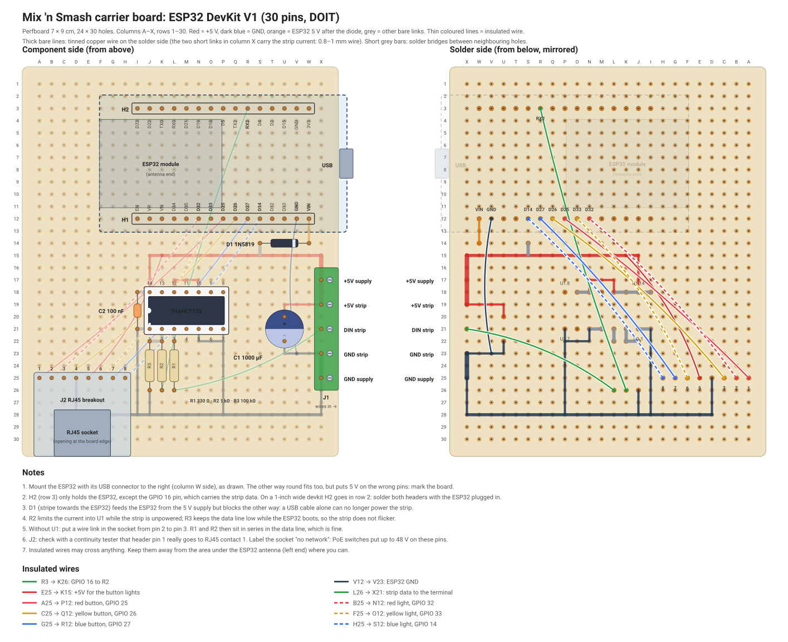

# Carrier board (perfboard)

A perfboard the ESP32 devkit plugs into, so it can come out again. Compared
with the [minimal wiring](wiring.md) it adds a few cheap parts that make the
setup more robust:

- **D1, a Schottky diode in the ESP32's 5 V feed.** The supply still powers
  the ESP32, but a USB cable alone can no longer power the strip through the
  devkit. Without it, the PC fed the strip through the devkit's small
  protection part: 84 °C with the supply off, smoke with the supply on.
  With D1 the PC can only power the ESP32 itself, so you can plug in USB at
  any time, with or without the supply; without the supply the strip simply
  stays dark.
- **U1, a 74AHCT125 level shifter** for the strip data, so the strip gets a
  clean 5 V signal. It sits in a socket and is optional, see the notes.
- **C1, 1000 µF** across the strip supply, against the inrush when the strip
  switches on.
- **Screw terminals** for the supply and the strip, and an **RJ45 socket** for
  the ethernet cable to the button bar.

The firmware needs no changes: the strip data stays on GPIO 16, the buttons
on GPIO 25/26/27 and the button lights on GPIO 32/33/14.

## Which drawing

The two common ESP32 devkits have their pins in a different order, so there
are two drawings. Count the pins on one side of your board and check the
labels of the three pins at the USB end:

| Pins per side | Last pins at the USB end | Drawing |
|---|---|---|
| 15 | D13, GND, VIN | [carrier-30pin.svg](carrier-30pin.svg) (ESP32 DevKit V1, DOIT) |
| 19 | SD3, CMD, 5V | [carrier-38pin.svg](carrier-38pin.svg) (ESP32-DevKitC) |

If the labels on your board match neither, do not build from these drawings:
the pins would end up on the wrong signals.

Each drawing shows the component side, with the wiring seen through the
board, and the solder side, mirrored as you see it when you turn the board
over. Holes are named by column letter (A–X, left to right on the component
side) and row number (1–30, top to bottom).

## Parts

| Ref | Part | Notes |
|---|---|---|
| | Perfboard 7 × 9 cm, 24 × 30 holes | single or double sided |
| H1, H2 | Female headers, 1 × 15 (30-pin devkit) or 1 × 19 (38-pin), two of them | cut from 1 × 40 strips |
| U1 | 74AHCT125 (DIP-14) and a 14-pin IC socket | SN74AHCT125N; HCT works too |
| D1 | 1N5819 Schottky diode | or any 1 A Schottky diode |
| C1 | 1000 µF electrolytic capacitor, 10 V or more | |
| C2 | 100 nF ceramic capacitor | |
| R1 | 330 Ω | in the data line to the strip |
| R2 | 1 kΩ | limits the current into U1 while the strip is unpowered |
| R3 | 100 kΩ | keeps the data line low while the ESP32 boots |
| J1 | Screw terminals, 5.08 mm pitch, 5 positions | a 2- and a 3-way block slid together |
| J2 | RJ45 breakout board with an 8-pin 2.54 mm header | |
| | Tinned copper wire 0.6–1 mm, thin insulated wire | |

## Building

1. **Headers.** Plug both female headers onto the ESP32, put it on the
   board with the USB connector at the right edge, and solder two corner
   pins of each header. Check that everything sits straight, solder the
   rest, and take the ESP32 out again. This also takes care of the row
   distance, which differs between devkits: on a 1-inch wide board H2 lands
   in row 2 instead of row 3. Only one H2 pin is wired (GPIO 16), so that
   makes no difference.
2. **Bare wires and solder bridges** on the solder side, see the table below.
   The two short links in column X (X15–X19 and X23–X25) carry the whole
   strip current: use 0.8–1 mm wire there.
3. **Low parts:** R1, R2, R3, D1 (stripe towards the ESP32, at W14), C2 and
   the IC socket (notch towards column A).
4. **J2, J1 and C1** (+ at U20).
5. **Insulated wires**, see the table for your devkit.
6. **Check before plugging anything in**, with the multimeter:
   - Supply off: no short between X17 (+5 V) and X25 (GND). The reading
     climbs slowly while C1 charges, which is fine.
   - Supply off: continuity from each RJ45 contact to its ESP32 header pin,
     using the wiring table.
   - Supply on, strip disconnected: X17, J18 (U1 pin 14) and E25 (RJ45
     pin 5) read 5 V. The ESP32's 5V/VIN pad (W12) reads about 4.7 V, which
     is 5 V minus the diode. All other header pads read 0 V, and so does
     the 3V3 pad.
7. **U1** into its socket (notch towards column A), then the **ESP32** with
   USB at the right edge. Mark that direction on the board: the other way
   round also fits, and puts 5 V on the wrong pins.

## Notes

- **Without U1:** put a short wire in the socket from pin 2 to pin 3. The
  data then goes from GPIO 16 through R2 and R1 straight to the strip, the
  same as the minimal wiring.
- **RJ45 numbering:** check with a continuity tester that header pin 1 of
  your breakout really goes to contact 1 of the socket; not every breakout
  is numbered the same way.
- **Not a network socket.** Label it. A PoE switch puts up to 48 V on these
  pins, which would destroy the ESP32 and the buttons.
- **Keep the antenna end free.** Route the insulated wires away from the
  left end of the ESP32 where you can, and keep metal out of that area.

## The button bar end

Use the same T568B colours. A second RJ45 breakout or a keystone jack in the
button bar keeps the cable unpluggable.

| RJ45 pin | Wire | Button bar | ESP32 |
|---|---|---|---|
| 1 | white-orange | red button | GPIO 25 |
| 2 | orange | red light, LED minus (through its resistor) | GPIO 32 |
| 3 | white-green | yellow button | GPIO 26 |
| 4 | blue | GND: the other side of all three buttons | GND |
| 5 | white-blue | +5 V: LED plus of all three lights | +5 V |
| 6 | green | yellow light, LED minus | GPIO 33 |
| 7 | white-brown | blue button | GPIO 27 |
| 8 | brown | blue light, LED minus | GPIO 14 |

The lights are optional, see [wiring.md](wiring.md#lights-in-the-buttons-optional).
Buttons with 12 V LED modules have a resistor of about 680 Ω, which gives
only about 2.5 mA at 5 V. Solder 220 Ω across that resistor for full
brightness. Switch the lights on in the settings page (*Knopverlichting*).

## Tables

Generated by `tools/carrier_layout.py --table`, which also checks the
layout: every net connected in one piece, no two nets touching, no parts on
top of each other.

#### Parts (both variants)

| Part | Holes | Notes |
|---|---|---|
| U1 74AHCT125 (socket) | pin 1 at J21, pin 14 at J18 | notch to the left (towards column A) |
| C2 100 nF | I18 – I21 |  |
| R3 100 kΩ | J22 – J26 |  |
| R2 1 kΩ | K22 – K26 |  |
| R1 330 Ω | L22 – L26 |  |
| D1 1N5819 | S14 – W14 | stripe (cathode) at W14 |
| C1 1000 µF | U20 – U22 | + at U20 |
| J1 screw terminals | X17 +5V supply, X19 +5V strip, X21 DIN strip, X23 GND strip, X25 GND supply | wires enter from the right edge |
| J2 RJ45 breakout | pins 1–8 at A25–H25 | socket opening at the bottom edge |

#### Bare wires and solder bridges (both variants)

| Net | Path | Kind |
|---|---|---|
| +5V | X15 → X19 | thick wire (strip current) |
| +5V | J15 → X15 | rail |
| +5V | X19 → U19 → U20 | wire |
| +5V | S14 → S15 | solder bridge |
| +5V | J15 → J18 | wire |
| +5V | J18 → L18 | solder bridge |
| +5V | L18 → L17 → N17 → N18 | wire |
| +5V | N18 → O18 | solder bridge |
| +5V | I18 → J18 | solder bridge |
| GND | X23 → X25 | thick wire (strip current) |
| GND | X25 → X28 | wire |
| GND | X28 → D28 | rail |
| GND | X23 → U23 → U22 | wire |
| GND | M21 → N21 | solder bridge |
| GND | N21 → N22 → P22 → P21 | wire |
| GND | P22 → P28 | wire |
| GND | I21 → J21 | solder bridge |
| GND | I21 → I28 | wire |
| GND | J26 → J28 | wire |
| GND | D25 → D28 | wire |
| ESP32 5V | W14 → W12 | wire |
| U1 input | K21 → K22 | solder bridge |
| U1 input | K22 → J22 | solder bridge |
| U1 output | L21 → L22 | solder bridge |

#### ESP32 DevKit V1 (30 pins, DOIT)

| From | To | What |
|---|---|---|
| R3 | K26 | GPIO 16 to R2 |
| V12 | V23 | ESP32 GND |
| E25 | K15 | +5V for the button lights |
| L26 | X21 | strip data to the terminal |
| A25 | P12 | red button, GPIO 25 |
| B25 | N12 | red light, GPIO 32 |
| C25 | Q12 | yellow button, GPIO 26 |
| F25 | O12 | yellow light, GPIO 33 |
| G25 | R12 | blue button, GPIO 27 |
| H25 | S12 | blue light, GPIO 14 |

Headers: H1 in row 12, H2 in row 3, columns I–W.

#### ESP32-DevKitC (38 pins)

| From | To | What |
|---|---|---|
| P3 | K26 | GPIO 16 to R2 |
| R12 | V23 | ESP32 GND |
| E25 | K15 | +5V for the button lights |
| L26 | X21 | strip data to the terminal |
| A25 | M12 | red button, GPIO 25 |
| B25 | K12 | red light, GPIO 32 |
| C25 | N12 | yellow button, GPIO 26 |
| F25 | L12 | yellow light, GPIO 33 |
| G25 | O12 | blue button, GPIO 27 |
| H25 | P12 | blue light, GPIO 14 |

Headers: H1 in row 12, H2 in row 3, columns E–W.
