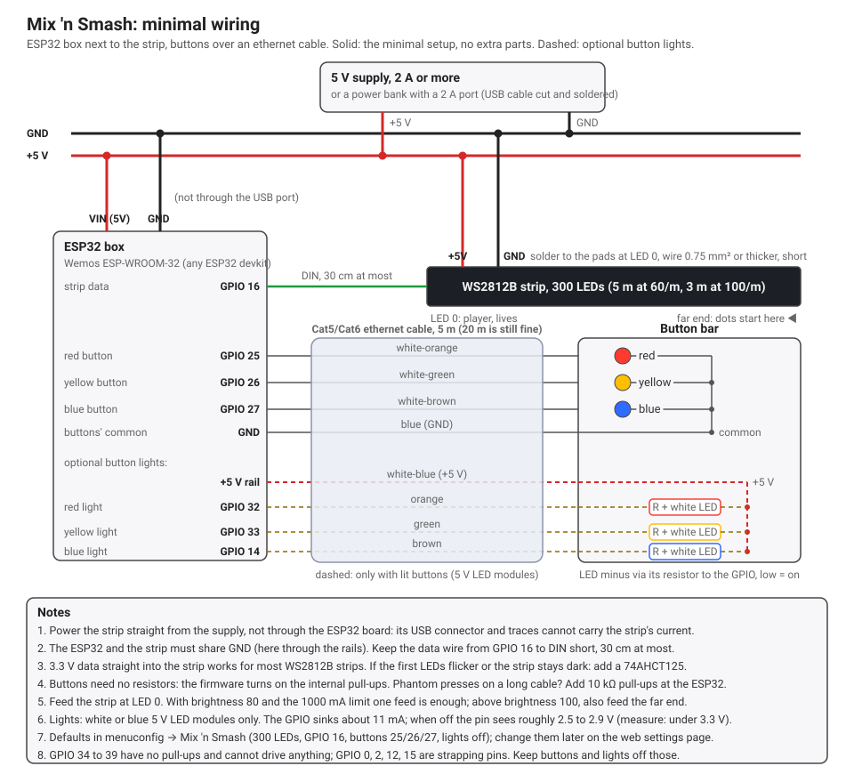

# Wiring (minimal setup)

The ESP32 sits in a small box next to the start of the LED strip, with the
5 V supply (or a power bank). The three buttons are in a separate bar,
connected over an ethernet cable. No resistors, capacitors or level shifter:
this is the simplest version that works. Lights in the buttons are optional
(dashed in the diagram) and need no extra parts either, see the end.

Want the ESP32 to be removable, with screw terminals and an RJ45 socket for
the button cable? See the [carrier board](carrier.md): the same connections on
a perfboard, plus a diode so a USB cable alone can never power the strip.

## Connections

| From | To | Wire | Notes |
|---|---|---|---|
| Supply +5 V | Strip +5 V pad at LED 0 **and** ESP32 `VIN` (5V pin) | 0.75 mm² or thicker, short | Not through the ESP32's USB port |
| Supply GND | Strip GND pad at LED 0 **and** ESP32 `GND` | 0.75 mm² or thicker, short | ESP32 and strip must share GND |
| ESP32 `GPIO 16` | Strip `DIN` at LED 0 | any thin wire, **30 cm at most** | 3.3 V straight into the strip; see note 3 |
| ESP32 `GPIO 25` | Red button | Cat5 white-orange | Button's other side to GND |
| ESP32 `GPIO 26` | Yellow button | Cat5 white-green | |
| ESP32 `GPIO 27` | Blue button | Cat5 white-brown | |
| ESP32 `GND` | Buttons' common | Cat5 blue | |
| *optional:* +5 V rail | LED plus of all three buttons | Cat5 white-blue | Only with lit buttons |
| *optional:* ESP32 `GPIO 32` | Red button's LED minus, through its resistor | Cat5 orange | |
| *optional:* ESP32 `GPIO 33` | Yellow button's LED minus | Cat5 green | |
| *optional:* ESP32 `GPIO 14` | Blue button's LED minus | Cat5 brown | |

Without lights, the last four conductors simply stay unconnected.

## Cables and lengths

| Cable | Length | What |
|---|---|---|
| Ethernet, Cat5e or Cat6, solid or stranded | 5 m (up to about 20 m is fine) | Buttons: slow DC signals, no special care needed |
| Data wire ESP32 → strip | 30 cm at most | 800 kHz signal at 3.3 V; keep it short, do not run it through the ethernet cable in this setup |
| Power wires supply → strip and → ESP32 | as short as practical | 0.75 mm² or thicker; the strip draws up to 1 A in this configuration |
| Strip itself | 300 LEDs, 5 m at 60/m or 3 m at 100/m | Feed at LED 0 (player side) |

## Notes

1. **Power the strip straight from the supply**, not through the ESP32
   board. Its USB connector, diode and traces are not made for the strip's
   current. The ESP32 gets 5 V on its `VIN`/`5V` pin from the same supply.
2. **Common ground.** The ESP32 and the strip share GND through the supply;
   without it the data signal has no reference and the strip shows garbage.
3. **Data without a level shifter.** The ESP32 outputs 3.3 V, the strip
   formally wants 3.5 V. In practice a short wire into a WS2812B strip works
   almost always. If the first LEDs flicker or the strip stays dark, add a
   74AHCT125 (or 74HCT245) between `GPIO 16` and `DIN`; that is the only
   extra part this setup might need.
4. **Buttons without resistors.** The firmware enables the ESP32's internal
   pull-ups (about 45 kΩ); a button simply shorts its wire to GND. The
   software debounce ignores anything shorter than 16 ms. If you ever see
   phantom presses on a long cable, add 10 kΩ pull-ups to 3.3 V at the
   ESP32 side.
5. **One feed is enough** at the default brightness (80) with the current
   limit at 1000 mA: nothing in the game lights more than a few dozen LEDs
   at once, and the heavy effects sit next to the feed. Above brightness
   100, also feed the far end with 2 × 1.5 mm².
6. **USB and the strip.** With this wiring, plugging only a USB cable into
   the ESP32 makes the PC's USB port power the whole strip through the devkit:
   the devkit's USB side gets very hot and Windows reports "USB device not
   recognized". Switch the 5 V supply on first, then plug in USB. The
   [carrier board](carrier.md) has a diode that prevents this.
7. **Power bank.** A bank with a 2 A port is fine: typical draw is about
   0.6 A, peaks around 1.2 A. Cut a short, thick USB cable and solder it to
   the rails; thin USB cables lose 0.3 to 0.5 V at 1 A. Set
   *Current limit* to 1000 mA in menuconfig.
8. **Pins to avoid** for the buttons: GPIO 34 to 39 have no internal
   pull-ups, GPIO 0, 2, 12 and 15 are strapping pins. GPIO 25, 26 and 27 are
   safe on every ESP32 board.
9. **Orientation.** LED 0 (the data input) is next to the player and shows
   the lives; dots come from the far end. If your strip's input ends up at
   the far end, turn on *Player sits at the far end* in menuconfig instead of
   rewiring.

## Firmware settings for this build

These are the menuconfig defaults (`pio run -t menuconfig` → *Mix 'n Smash*).
Everything except the strip direction and the frame period can also be
changed later on the settings page of the web interface, which wins once
saved; holding red + blue while powering on brings the defaults back.

| Setting | Value |
|---|---|
| LED strip → Number of LEDs | 300 |
| LED strip → Data GPIO | 16 |
| LED strip → Brightness | 80 (default) |
| LED strip → Current limit | 1000 mA (power bank) |
| Buttons → Red / yellow / blue GPIO | 25 / 26 / 27 (default) |
| Buttons → Buttons connect to 3.3 V instead of GND | off (default) |
| Buttons → Lights in the buttons | off until wired; then on, GPIO 32 / 33 / 14 |
| Buttons → Lights are switched by a transistor | off (the GPIO sinks the LED current) |

## Lights in the buttons (optional)

Arcade buttons with a 5 V LED module (an LED with its series resistor,
around 100 to 220 Ω) can be driven straight from the ESP32 without a
transistor, by letting the GPIO *sink* the current instead of supplying it:

- LED plus → +5 V (Cat5 white-blue, from the rail in the ESP32 box).
- LED minus, through the module's resistor → the GPIO (orange, green, brown
  to GPIO 32, 33, 14).
- The firmware sets the pin to open-drain: low = on, released = off.

With a white LED the numbers work out: 5 V minus about 3 V for the LED minus
0.3 V across the pin leaves 1.7 V over the resistor, so about 11 mA per
button, which the ESP32 can sink comfortably (up to about 28 mA per pin).

When the light is off, only the pin's leakage current flows. At such a tiny
current a white LED drops less than its nominal 2.8 V, about 2.1 to 2.5 V,
so the pin sees roughly **2.5 to 2.9 V**: below the 3.3 V supply and the
3.6 V absolute maximum, but not by a huge margin. That is why this only works
with **white or blue** LEDs (a red one would push the pin over 3.3 V), and
why **12 V modules** (resistor of 470 Ω or more) are out: too dim. Measure
the pin voltage with the light off after wiring it; under 3.3 V is fine.

If you want more margin, switch the three LEDs with a ULN2003 (or three
2N7000) and turn on *Lights are switched by a transistor* in menuconfig;
the wiring at the button bar stays the same, only the LED returns go to the
transistors instead of the GPIOs.

What the lights do: a chase red → yellow → blue while the strip waits for a
player, all on during the countdown and the game, a short blink of the button
that was pressed, fast blinking when a level is cleared, slow blinking at
game over, and off while the colour chart is shown.
